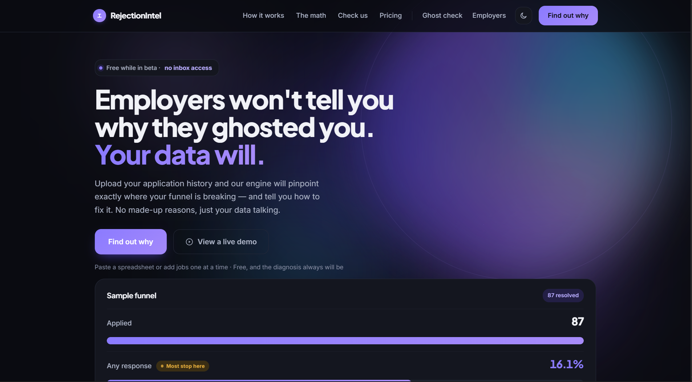
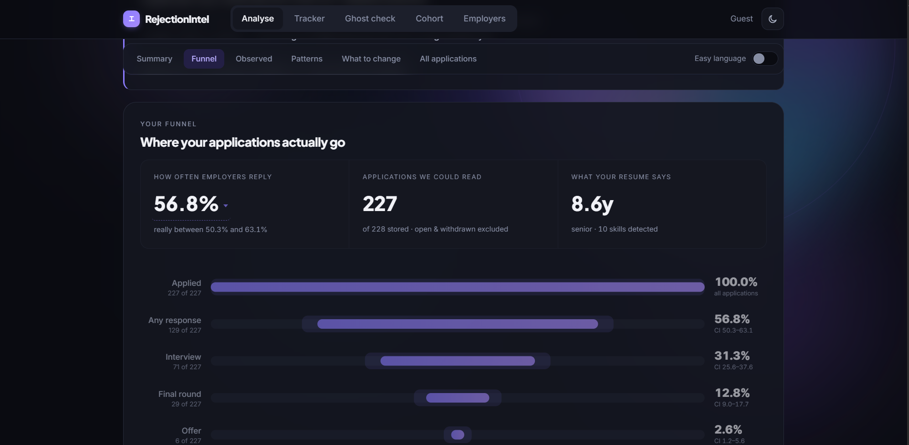
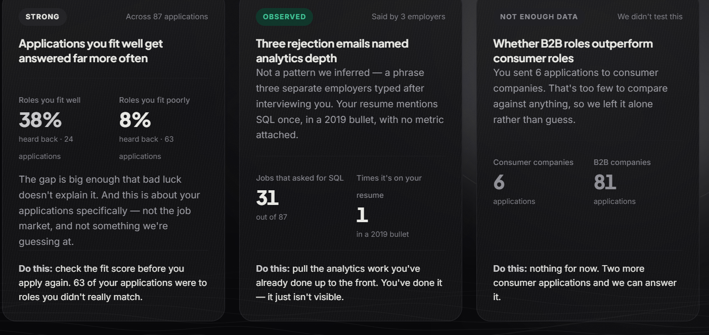

# RejectionIntel

Job-search analytics that tells you where your applications are actually
failing, in plain English, with an explicit statement of how confident it is.

Upload a spreadsheet of applications and a resume. It derives the funnel,
tests pre-registered hypotheses against it, corrects for multiple comparisons,
and narrates the result. The distinguishing feature is not the analysis — it is
the **refusal to overclaim**. "We don't know yet" is a designed screen, not a
failure state.







**Stack:** Python, FastAPI, SQLAlchemy (SQLite or Postgres), optional Gemini/Claude narration, D3.js front end, Chrome extension for capturing applications.

---

## Running it

```
python -m venv .venv
.venv\Scripts\activate          # Windows
pip install -r requirements.txt
python run.py
```

Then open `http://127.0.0.1:8000`. Nothing else is required — no API key, no
database server. It runs on SQLite with a deterministic engine, and the LLM
layer degrades to templates when no key is set.

To populate the shared views with sample data:

```
python -m sample.seed_demo        # 40 fictional users
python -m sample.seed_demo --clear
```

---

## Where the AI sits

```
CSV → parse → deterministic maths → statistics → AI narration
                                                      ▲ enters here only
```

The model does exactly two things: it reads job-description prose into a typed
schema, and it turns finished numbers into sentences. It never scores, ranks,
predicts or decides. Four guards enforce this:

1. **Numeric guard** — a number in AI output that is absent from the computed
   facts causes the draft to be rejected, retried once, then replaced with a
   deterministic template.
2. **Verbatim guard** — an employer's stated reason must be a literal substring
   of their actual message. A paraphrase is an inference wearing a quotation.
3. **All-or-nothing extraction** — a report is entirely model-parsed or
   entirely vocabulary-parsed, never mixed. Mixing shifts fit scores by around
   27 points and manufactures a pattern that is an artefact of the parser.
4. **Invented-metric guard** — resume suggestions are shapes with blanks. Any
   digit not present in the source line is rejected.

---

## The statistics

Wilson score intervals on every rate, Fisher's exact test for each hypothesis,
Benjamini–Hochberg correction across the whole run rather than per finding.

Hypotheses are pre-registered before any data is examined, so the set being
corrected for is fixed in advance and cannot be expanded after seeing which
ones look promising.

Validated against 300 simulated users drawn from pure noise:
**0.02 false "strong" findings per user.**

Findings below the evidence threshold are reported as insufficient rather than
suppressed, because "not enough data" is itself the answer to a real question.

---

## What is in here

| Path | |
|---|---|
| `core/` | Analysis engine — ingest, scoring, statistics, narration, cohorts |
| `api/main.py` | FastAPI application, 40 endpoints |
| `site/` | Six pages. Vanilla JS, D3, custom CSS variables. No framework, no build step |
| `tests/` | Four suites: pipeline, HTTP routes, DOM ordering, share-card redaction |
| `sample/` | Demo data and five test personas |

Documentation: `RUNNING.md`, `ARCHITECTURE.md`, `POSTGRES.md`, `ROLLBACK.md`.

---

## Status

Working and testable end to end. Not yet used by anyone.

Every number this system has produced came from synthetic data that cooperates:
clean dates, skill names that match the vocabulary, outcomes drawn from a
distribution chosen in advance. **Running real applications through the ingest
is the highest-value outstanding task**, and no amount of infrastructure work
substitutes for it.

Known gaps, stated plainly:

- Never processed a real job search
- Email delivery is built but needs a domain and provider key
- Every hypothesis tests *response*; nothing tests *given a reply, did they
  progress*, so a user whose bottleneck is post-reply gets an empty Patterns tab
- Single-process queue by default; the Redis adapter exists but is not activated

---

## Licence

None yet. Add one before making the repository public — without a licence file,
default copyright applies and nobody can legally use or contribute to it.
